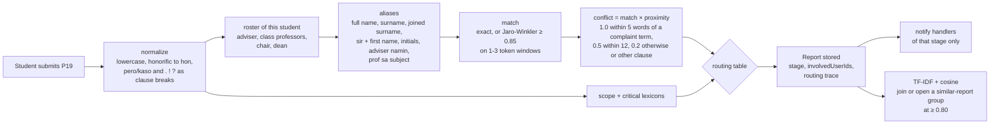

# Context-aware escalation: proof of concept

Branch `feat/context-aware-escalation` in accs-backend (based on `feat/29-remove-presidents-office`, the most advanced branch on 2026-11-11) and in accs-frontend (based on `dev`).
Spec: [delta 2026-11-09](../../../docs/deltas/2026-11-09-context-aware-escalation-engine.md). Plan: [plan](../plans/2026-11-09-context-aware-escalation-plan.md). The engine is rule-based. It uses no LLM and calls no external service.

## Where the report goes

The student files the report on P19. While the request runs, the API picks the **first office**, using the report text together with the student's own roster: their adviser, their class professors, their Program Chair and the Dean.

| First match wins | First office | Kept out (`involvedUserIds`) |
|---|---|---|
| Critical words (on by default; `ESCALATION_CRITICAL_TO_GUIDANCE=false` turns it off) | Guidance Office | — |
| Student ticked "about my adviser", sent `conflictedAdviser`, listed the adviser, or wrote the adviser's full name | Program Chair | adviser |
| Adviser conflict score ≥ 0.60 | Program Chair | adviser |
| Subject professor conflict ≥ 0.60 | Program Chair | that professor |
| Adviser or subject professor score between 0.30 and 0.60 | Program Chair, flagged "check for conflict" | — |
| Scope is the whole program or college | Program Chair | — |
| Otherwise | Adviser | — |
| Program Chair conflict ≥ 0.60 (a chair who also teaches the student counts as the chair), with `ESCALATION_HIGHER_BYPASS=true` (off by default) | Dean | chair |

When a switch is off, the row falls through and the handler gets a note instead ("The Program Chair may be involved", "Consider referring this concern to the Guidance Office"). The critical-word switch is on by default. The higher-office bypass stays off until the escalation authority decision is approved. A report that starts at Guidance has no case file, so the queue hides it.

If no active Guidance user can receive a critical report, it goes to the Program Chair instead, never the adviser, and the history records the reason. If the chair cannot receive it either, the request is refused with 409.

`bypassed` now means "the report went around the adviser" for every Program Chair row, including whole-program and possible-conflict reports. Those reports also lock the adviser out, and they count in the "Adviser bypassed" tag, the chair's Bypassed tab and the analytics figure. `aboutAdvisor` is set only when the adviser is the concern.

The student only sees "With the Program Chair". The handler sees why, on the case page (P22).

## How it is processed



Code:

- `backend/src/escalation/lexicon.ts`: word lists, thresholds, the two switches, and the engine and lexicon versions.
- `backend/src/escalation/engine.ts`: `normalize`, `jaroWinkler`, `aliasesFor`, `rosterFor`, `mentionsIn`, `scopeOf`, `route`.
- `backend/src/escalation/similarity.ts`: TF-IDF with smoothed IDF, `cosine`, `assign`.
- `backend/src/services.ts` `createReport`: calls `route()`, stores `report.routing`, then runs `groupSimilar()`. P23 reads the threshold from the config.
- `backend/src/dev.ts` `POST /api/dev/escalation/try`: dev stack only. Returns the decision and the roster aliases and stores nothing.
- `frontend/src/components/app/grievance.tsx` `ConflictNotice`: shows the matched name, the complaint word and the score to the handler.
- `frontend/src/components/dev-toolbox/escalation-lab.tsx`: the "Escalation lab" in the dev toolbox.

The stored trace looks like this (handlers only; the owner's view leaves it out):

```json
{ "engineVersion": "escalation-0.2.0", "lexiconVersion": "lexicon-2026-11-11", "rule": "adviser-conflict", "scope": "section",
  "mentions": [{ "personId": "QCU-PROF-CS", "name": "Demo Professor Echo", "role": "adviser", "alias": "echo", "aliasKind": "surname",
                 "matchScore": 1, "term": "laging absent", "distance": 0, "proximity": 1, "conflict": 1 }],
  "heldBack": [], "thresholds": { "bypass": 0.6, "triage": 0.3 } }
```

## Proof

| Screenshot | Shows |
|---|---|
| `01-lab-adviser-conflict.png` | "Si sir Echo laging absent…" filed as Demo Student Hotel goes to the Program Chair, and Demo Professor Echo is kept out |
| `02-lab-helper-mention.png` | "Tinulungan ako ni sir Echo, pero yung registrar…" stays with the adviser. The score is 0.2 because the complaint is in another clause |
| `lab-results.json` | Full engine output for seven samples from the running app: a typo too short for fuzzy matching ("brok"), a fuzzy look-alike ("broke"), a chair conflict held back, a program-wide concern and a critical word |
| `03-student-view.png` | The student's report page shows the destination only |
| `04-chair-case-routing.png` | The Program Chair's case page shows the reason, the matched alias, the complaint word and the score |

Labeled set `backend/tests/fixtures/escalation/reports.json`: 48 synthetic Taglish and English reports with invented names. It includes 8 hard negatives: the student's own lateness, a classmate with the same surname, a building named after the person, initials used for something else, and "dean's list". **Treat these numbers as a smoke check, not an evaluation.** The set was written alongside the lexicon by the same author. Results from `tests/escalation.test.ts`:

| Measure | Result | Delta target |
|---|---|---|
| Conflict precision | 0.95 | ≥ 0.85 |
| Conflict recall | 0.87 | ≥ 0.95 (**not met**) |
| Routing accuracy | 0.96 | ≥ 0.90 |
| Critical-word hint | 48 of 48 | — |

The test asserts floors (precision 0.85, recall 0.80, routing 0.90) so that regressions fail. Known misses:

- Pronoun reference: in "sir jdc sinabihan kami…, tapos **siya** mismo hindi pumapasok" the name is too far from the complaint. It still went to the Program Chair as a possible conflict.
- A nickname that cannot be built from the name: "sir dlc".
- A name 6 words from the complaint ("walang feedback … si maam santos"): it scored 0.5 and went to the chair with the flag.
- A classmate who shares a faculty member's surname ("si Paolo Santos laging late") is read as the professor. This is a false bypass to the chair, which is the safe direction.

Collision guards: initials always need "sir/ma'am"; a surname of 3 letters or fewer, or one that is a stopword, also needs the honorific; a near-miss spelling counts only right after "sir/ma'am" or "si/ni/kay", and only from 5 letters. "Dr." and "Prof." do not end a clause.

Self-reference: a complaint term next to "ako", "ko", "i" or "im" is the student describing themselves ("late ako", "I was late") and is not a complaint. The exception is "ko" right after a person word (adviser, advisor, chair, chairperson, dean, or an honorific such as sir, ma'am, prof, teacher, dr), where it means "my". "Yung adviser ko hindi nagrereply" goes to the Program Chair as an adviser conflict.

API tests also cover these cases: a student-listed chair stays locked out; a complaint about a chair who teaches the student is accepted (it stays with the adviser, with a note); the trace and a new group survive a reload from the record store.

## Try it locally

```sh
# backend worktree
cd accs-system/backend-escalation && NODE_ENV=development PORT=3100 CORS_ORIGIN=http://localhost:5273 npx tsx src/index.ts
# frontend worktree
cd accs-system/frontend-escalation && ACCS_DEV_API_TARGET=http://localhost:3100 npx vite --port 5273
```

Sign in as `QCU-STU-CS` and open the dev toolbox (bottom right), then choose **Escalation lab**. To test the Dean route, start the API with `ESCALATION_HIGHER_BYPASS=true`. To test routing without the Guidance route, start it with `ESCALATION_CRITICAL_TO_GUIDANCE=false`.

## Not built yet

- Phase 5: the agreement score and the post-to-report prompt (STU-08).
- The full set of 150 or more labeled reports. The team writes these.
- Faculty-defined nicknames. The `User` record has no alias field yet.
- Dissent and supporting statements on groups. They are placeholder text.
- A self-hosted decision model as a shadow second opinion. It is planned in [the decision-model plan](../plans/2026-11-11-decision-model-shadow-plan.md) and needs approval before it can affect routing.
- An admin screen for thresholds and lexicons. For now they live in `lexicon.ts` and two environment variables.
- Group titles and phrases come from report text. A report whose chair is listed as involved, or one marked confidential after it was filed, still feeds them. The same student filing twice forms a group.
- Stale text not touched here: the frontend `nextOffices` still lists the President's Office, the FAQ "How are reports routed?" describes the old rule, and the delta still has a row for the President's Office.
